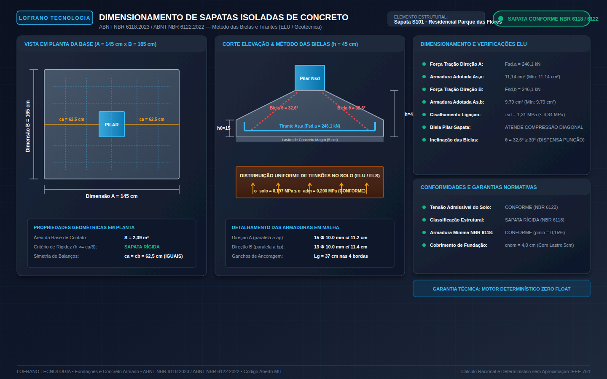

# Dimensionamento e Verificação de Sapatas Isoladas de Concreto Armado (ABNT NBR 6118:2023 / NBR 6122:2022)

[](https://github.com/martinlofranodeoliveira/dimensionamento-sapatas-concreto-nbr6118/actions/workflows/ci.yml)
[](LICENSE)
[](https://www.python.org/)
[](#garantias-técnicas)
[-emerald.svg)](#aritmética-exata-zero-float)
[](https://www.abnt.org.br/)

Motor analítico, determinístico e de código aberto para dimensionamento geotécnico, verificação estrutural e detalhamento normativo de **sapatas isoladas rígidas de concreto armado** sob pilares retangulares, segundo as normas **ABNT NBR 6118:2023** (*Projeto de estruturas de concreto - Procedimento*) e **ABNT NBR 6122:2022** (*Projeto e execução de fundações*).

Desenvolvido sob o padrão de engenharia de software de alta confiabilidade da **LOFRANO TECNOLOGIA**, este sistema opera com **Zero Float** (100% dos cálculos físicos, geométricos e normativos utilizam frações exatas com `fractions.Fraction` e inteiros), eliminando qualquer erro de arredondamento cumulativo ou imprecisões binárias da norma IEEE-754.

---

## Painel Técnico Vetorial (Renderização 1440x900)

O motor gera automaticamente um painel técnico vetorial SVG em alta resolução contendo a planta baixa da sapata e pilar, o corte transversal esquemático com a inclinação das bielas de compressão ($\theta$), as armaduras de flexão detalhadas (diâmetro, quantidade e espaçamento), e a memória de cálculo consolidada:



---

## Fundamentação Matemática e Formulações Normativas

O pacote implementa o método clássico e rigoroso das **Bielas e Tirantes** para elementos de fundação direta rígidos:

### 1. Dimensionamento Geotécnico da Base ($A \times B$)
Para garantir distribuição uniforme de pressões no solo e evitar momentos secundários, dimensiona-se a base com balanços iguais em ambas as direções ($c_a = c_b$):
- **Carga Total de Serviço**:
  $$N_{\text{tot},k} = 1{,}05 \cdot N_k \quad (\text{acréscimo de 5\% de peso próprio})$$
- **Área Mínima Necessária**:
  $$S_{\text{nec}} = \frac{N_{\text{tot},k}}{\sigma_{\text{adm}}}$$
- **Condição de Balanços Iguais**:
  $$c_a = \frac{A - a_p}{2}, \quad c_b = \frac{B - b_p}{2}$$
  $$c_a = c_b \implies A - B = a_p - b_p$$
- **Resolução Analítica Quadrática**:
  Substituindo $A = B + (a_p - b_p)$ em $A \cdot B = S_{\text{nec}}$:
  $$B^2 + (a_p - b_p) \cdot B - S_{\text{nec}} = 0$$
  $$B = \frac{-(a_p - b_p) + \sqrt{(a_p - b_p)^2 + 4 \cdot S_{\text{nec}}}}{2}$$
  $$A = B + (a_p - b_p)$$
  As dimensões $A$ e $B$ são arredondadas para múltiplos superiores de $5\text{ cm}$.
- **Tensão Efetiva no Solo**:
  $$\sigma_{\text{ef}} = \frac{N_{\text{tot},k}}{A \cdot B} \le \sigma_{\text{adm}}$$

---

### 2. Altura Total ($h$), Borda ($h_0$) e Critério de Rigidez
Segundo a ABNT NBR 6118:2023 (item 22.4), a sapata é classificada como rígida quando suas deformações por flexão são desprezíveis em comparação com as tensões do solo:
- **Critério de Rigidez Geométrica**:
  $$h \ge \frac{A - a_p}{3} = \frac{2}{3} c_a \quad \text{e} \quad h \ge \frac{B - b_p}{3} = \frac{2}{3} c_b$$
  $$h \ge 30\text{ cm} \quad (\text{espessura mínima construtiva})$$
- **Garantia de Inclinação da Biela ($\theta \ge 30^\circ$)**:
  $$\tan \theta = \frac{d}{c} \ge \tan(30^\circ) = \frac{\sqrt{3}}{3} \approx 0{,}577$$
  $$d \ge \max(c_a, c_b) \cdot 0{,}577 \implies h \ge \max(c_a, c_b) \cdot 0{,}577 + c_{\text{nom}} + 1\text{ cm}$$
- **Altura da Borda Lateral**:
  $$h_0 \ge \frac{h}{3} \ge 15\text{ cm}$$
  Arredondada para múltiplos de $5\text{ cm}$.

---

### 3. Flexão pelo Método das Bielas e Tirantes (ELU)
- **Esforço Normal Majorado**:
  $$N_{sd} = \gamma_f \cdot N_k = 1{,}40 \cdot N_k$$
- **Forças de Tração nos Tirantes**:
  $$F_{sd,a} = \frac{N_{sd} \cdot (A - a_p)}{8 \cdot d}$$
  $$F_{sd,b} = \frac{N_{sd} \cdot (B - b_p)}{8 \cdot d}$$
- **Área de Aço Calculada**:
  $$A_{s,a} = \frac{F_{sd,a}}{f_{yd}}, \quad A_{s,b} = \frac{F_{sd,b}}{f_{yd}}$$
  Onde $f_{yd} = f_{yk} / \gamma_s = 50 / 1{,}15 = 43{,}478\text{ kN/cm}^2$ (para aço CA-50).
- **Armadura Mínima de Flexão**:
  $$A_{s,\min,a} = \rho_{\min} \cdot (B \cdot h) = 0{,}0015 \cdot B \cdot h$$
  $$A_{s,\min,b} = \rho_{\min} \cdot (A \cdot h) = 0{,}0015 \cdot A \cdot h$$
  $$A_{s,\text{adotado}} = \max(A_{s,\text{calc}}, A_{s,\min})$$

---

### 4. Verificação de Punção e Compressão Diagonal (ELU)
- **Perímetro Crítico $u_0$ no Contorno do Pilar**:
  $$u_0 = 2 \cdot (a_p + b_p)$$
- **Tensão Solicitante de Cálculo**:
  $$\tau_{sd} = \frac{N_{sd}}{u_0 \cdot d}$$
- **Tensão Resistente de Compressão Diagonal ($\tau_{Rd2}$)**:
  $$\tau_{Rd2} = 0{,}27 \cdot \left(1 - \frac{f_{ck}}{250}\right) \cdot f_{cd}$$
  Condição de segurança: $\tau_{sd} \le \tau_{Rd2}$.
- **Dispensa de Armadura Transversal de Punção**:
  Para sapatas rígidas com $\theta \ge 30^\circ$, o mecanismo resistente forma-se por bielas diretas de concreto entre o pilar e a base, dispensando estribos contra punção no contorno crítico $C'$.

---

### 5. Detalhamento da Malha e Ancoragem
- **Número de Barras por Direção**:
  $$n_{\text{barras}} = \max\left(\left\lceil \frac{A_s}{A_{\phi}} \right\rceil, 2\right)$$
- **Espaçamento Uniforme**:
  $$s = \frac{L - 2 \cdot c_{\text{nom}}}{n - 1} \le 20\text{ cm}$$
- **Comprimento Básico de Ancoragem**:
  $$l_b = \frac{\phi}{4} \cdot \frac{f_{yd}}{f_{bd}} \ge l_{b,\min}$$

---

## Garantias Técnicas LOFRANO TECNOLOGIA

1. **Aritmética Exata (Zero Float)**: Cálculos contínuos expressos exclusivamente em frações exatas (`fractions.Fraction`) e inteiros.
2. **Codec Canônico JSON**: Rejeição de floats não-canônicos, BOM UTF-8 (`\xef\xbb\xbf` / `\ufeff`), chaves duplicadas e profundidade excessiva (> 32 níveis).
3. **Segurança CSV**: Sanitização ativa contra injeção de fórmulas (`=`, `+`, `-`, `@`, `\t`, `\r`).
4. **Painel SVG Vetorial 1440x900**: Representação em planta, corte, bielas inclinadas e especificações de armaduras.
5. **Captura Headless Chrome**: Validação visual automatizada gerando `docs/exemplo.png`.
6. **Empacotamento ZIP Determinístico**: Geração byte-a-byte reproduzível com timestamp fixo (`2026-01-01 00:00:00`) e flags seguras `os.O_EXCL | os.O_CREAT`.
7. **Suíte Completa com 55+ Testes**: Testes unitários com validação analítica completa.
8. **Auditor Independente em SQLite (`tools/verify_independent.py`)**: Script autônomo que valida os cálculos em banco `:memory:` sem importar o código de produção.
9. **CI Multiplataforma**: Execução em Linux (Python 3.11, 3.12, 3.13, 3.14) e Windows (Python 3.14) com isolamento total de rede (`unshare -r -n`).

---

## Estrutura do Repositório

```
dimensionamento-sapatas-concreto-nbr6118/
├── .github/
│   └── workflows/
│       └── ci.yml               # Workflow de Integração Contínua Multiplataforma
├── docs/
│   ├── exemplo.svg              # Painel técnico vetorial SVG
│   └── exemplo.png              # Captura rasterizada em 1440x900
├── examples/
│   ├── sapata_residencial_pilar_retangular.json
│   └── sapata_edificio_carga_elevada.json
├── scripts/
│   ├── generate_assets.py       # Gerador determinístico de assets e checksums
│   └── check_distribution.py   # Verificador de integridade do pacote
├── src/
│   └── sapatas_concreto_nbr6118/
│       ├── __init__.py
│       ├── py.typed             # Marcador de tipagem PEP 561
│       ├── constants.py         # Constantes, tabelas CAA e bitolas comerciais
│       ├── models.py            # Dataclasses de entrada e saída
│       ├── calculator.py        # Motor analítico exato (Zero Float)
│       ├── codecs.py            # Serializador/Desserializador canônico
│       ├── exporters.py         # Exportadores de relatório e planilha sanitizada
│       ├── svg_generator.py     # Gerador do painel técnico SVG
│       └── cli.py               # Interface de linha de comando (CLI)
├── tests/                       # 55+ testes unitários rigorosos
│   ├── test_constants.py
│   ├── test_models.py
│   ├── test_calculator.py
│   ├── test_codecs.py
│   ├── test_exporters.py
│   ├── test_svg_generator.py
│   ├── test_cli.py
│   └── test_packaging.py
├── tools/
│   └── verify_independent.py   # Auditor independente em SQLite
├── LICENSE                      # Licença MIT
├── pyproject.toml               # Configuração do pacote e metadados de build
└── README.md                    # Documentação técnica em Português
```

---

## Instalação e Requisitos

- Python 3.11 ou superior.
- **Zero dependências externas de terceiros** (somente biblioteca padrão do Python).

```bash
git clone https://github.com/martinlofranodeoliveira/dimensionamento-sapatas-concreto-nbr6118.git
cd dimensionamento-sapatas-concreto-nbr6118
pip install .
```

---

## Uso da Interface de Linha de Comando (CLI)

O pacote expõe o comando `sapatas-concreto`:

### 1. Dimensionamento via Arquivo JSON
```bash
sapatas-concreto dimensionar \
  --arquivo examples/sapata_residencial_pilar_retangular.json \
  --relatorio memorial.txt \
  --json-saida resultado.json \
  --csv planilha.csv \
  --svg painel.svg
```

### 2. Dimensionamento Rápido via Argumentos
```bash
sapatas-concreto dimensionar \
  --ap 20 \
  --bp 40 \
  --nk 450 \
  --sigma-adm 0.20 \
  --fck 25 \
  --caa CAA_II
```

### 3. Consulta de Tabelas Normativas e Materiais
```bash
sapatas-concreto tabelas
sapatas-concreto materiais
```

---

## Uso Programático (API Python)

```python
from fractions import Fraction
from sapatas_concreto_nbr6118 import (
    PilarApoiado,
    PropriedadesSolo,
    PropriedadesMateriais,
    ProjetoSapata,
    dimensionar_sapata_concreto,
    gerar_relatorio_memorial,
)

pilar = PilarApoiado(
    largura_ap_cm=Fraction(20, 1),
    comprimento_bp_cm=Fraction(40, 1),
    carga_normal_nk_kn=Fraction(450, 1),
)

solo = PropriedadesSolo(
    tensao_admissivel_sigma_adm_mpa=Fraction(20, 100),
    descricao_camada="Solo arenoso medianamente compacto",
)

materiais = PropriedadesMateriais(
    classe_concreto_fck=25,
    classe_agressividade="CAA_II",
)

projeto = ProjetoSapata(
    pilar=pilar,
    solo=solo,
    materiais=materiais,
    identificacao="Sapata S101",
)

resultado = dimensionar_sapata_concreto(projeto)

print(f"Dimensões A x B: {resultado.geometria.dimensao_a_cm} x {resultado.geometria.dimensao_b_cm} cm")
print(f"Altura h: {resultado.geometria.altura_total_h_cm} cm (d = {resultado.geometria.altura_util_d_cm} cm)")
print(f"Armadura Dir A: {resultado.detalhamento_a.quantidade_barras} Φ {resultado.detalhamento_a.diametro_adotado_mm} mm c/ {resultado.detalhamento_a.espacamento_cm} cm")
print(f"Status Geral: {'APROVADO' if resultado.atende_geral else 'REPROVADO'}")
```

---

## Licença

Distribuído sob os termos da [Licença MIT](LICENSE). Engenharia aberta, acessível e confiável.
